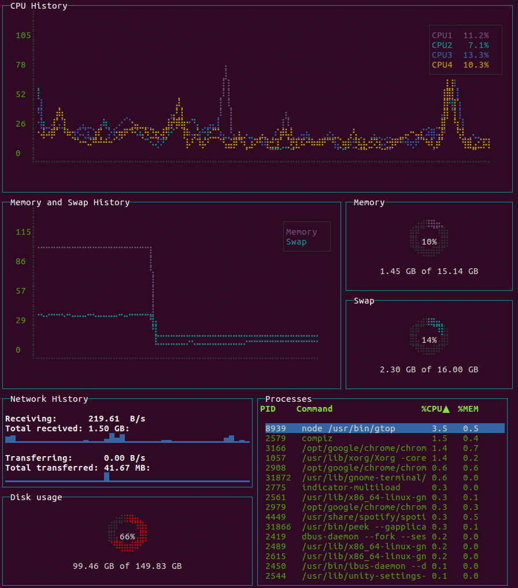

# gtop



System monitoring dashboard for terminal.

  [](https://npmjs.org/package/gtop)
  [](https://npmjs.org/package/gtop)
  [](https://snapcraft.io/gtop)
  [](https://hub.docker.com/r/aksakalli/gtop)
  [](https://hub.docker.com/r/aksakalli/gtop/builds)

### Requirements

* Linux / OSX / Windows (partial support)
* Node.js >= v8

### Installation

```sh
$ npm install gtop -g
```

#### npm install troubleshooting

If `npm install gtop -g` fails, work through these checks before opening a new issue:

* Confirm that Node.js is installed and available in the same shell that runs npm.
* Use a maintained Node.js release; gtop requires Node.js v8 or newer, and current LTS releases are preferred.
* Check both versions with `node --version` and `npm --version` to make sure your PATH is not finding an old copy.
* Upgrade npm when install output suggests an npm bug or an unsupported lockfile format.
* On macOS or Linux, avoid running the install with `sudo` until you have checked npm's global prefix.
* Inspect the global prefix with `npm config get prefix` and make sure your user can write to that directory.
* If the prefix points to a system directory, switch to a user-owned prefix or use a Node version manager.
* If npm reports `EACCES`, fix npm permissions instead of changing random files to be world-writable.
* If npm reports `ENOENT`, verify that `node`, `npm`, and the global npm bin directory are all on PATH.
* If npm reports network or registry errors, retry with a stable connection and confirm `npm config get registry`.
* If your environment uses a proxy, configure npm's `proxy` and `https-proxy` settings before reinstalling.
* If installation stops while building dependencies, install the native build tools for your platform.
* On Debian or Ubuntu, the usual build prerequisites are `build-essential`, `python3`, and `make`.
* On macOS, install the Xcode command line tools with `xcode-select --install` when compiler errors appear.
* On Windows, install the npm native build tools recommended by the Node.js documentation.
* Remove a broken previous install with `npm uninstall gtop -g` before trying a clean reinstall.
* Clear npm's cache only when npm says the cache is corrupt: `npm cache verify` is safer than deleting it.
* Try `npm install gtop -g --verbose` to capture the first real error message for troubleshooting.
* After a successful install, run `npm bin -g` and confirm that directory is included in your shell PATH.
* Verify the command with `gtop --help` or start it with `gtop` from a new terminal session.
* If the global command is still unavailable, try `npx gtop` to separate PATH issues from package install issues.
* If `npx gtop` works but `gtop` does not, the package installed correctly and only your PATH needs adjustment.
* If you cannot use npm globally, consider the Docker or Snap installation methods below.
* When reporting an install problem, include your operating system, Node.js version, npm version, command used, and complete error output.
* Mention which step above failed so maintainers can distinguish npm, permissions, PATH, and native build failures.

#### Docker

You need to assign host `net` and `pid` to access the metrics in the host machine.

```sh
$ docker run --rm -it \
    --name gtop \
    --net="host" \
    --pid="host" \
    aksakalli/gtop
```

### Usage

Start gtop with the `gtop` command

```sh
$ gtop
```

To stop gtop use `q`, or `ctrl+c` in most shell environments.

You can sort the process table by pressing

* `p`: Process Id
* `c`: CPU usage
* `m`: Memory usage

### Troubleshooting

If you see question marks or other different characters, try to run it with these environment variables:

```sh
$ LANG=en_US.utf8 TERM=xterm-256color gtop
```

## License

Released under [the MIT license](LICENSE).
